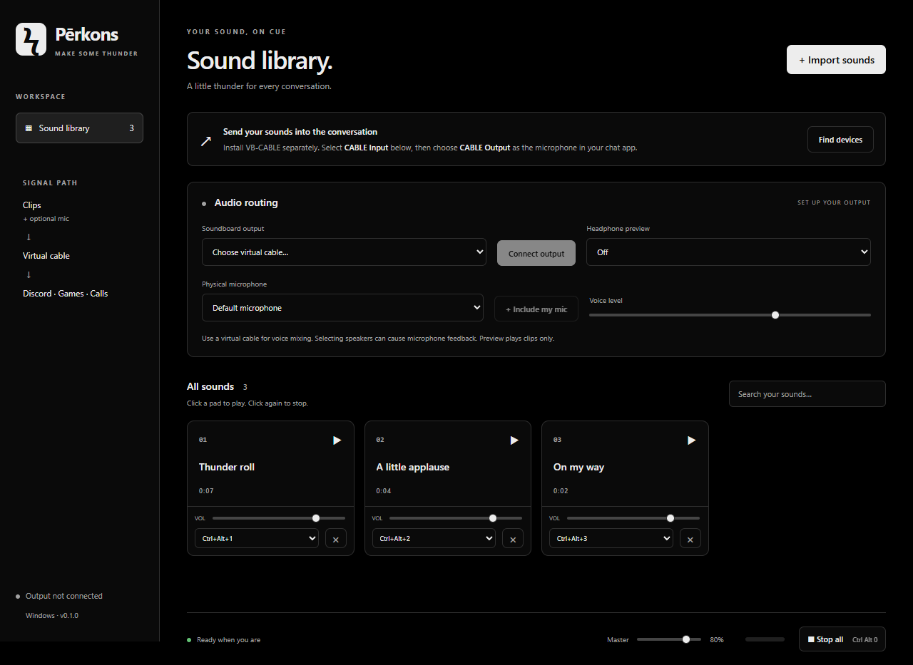

# Pērkons

A Windows soundboard for sending audio clips and your microphone into Discord, games, and calls. Built with React, TypeScript, Electron, and Web Audio, with a Geist-inspired dark interface.



## Run the Windows app

1. Open this repository's **Releases** page and download **`Perkons-0.1.0-portable.exe`** from the release assets. Choose the latest version when a newer one is available.
2. Put the executable somewhere convenient, such as a folder under Documents.
3. Double-click it to launch Pērkons. Create a Windows shortcut to it if you want quicker access.

**No PowerShell, Node.js, npm, or source checkout is needed to run the executable.** This build targets Windows 10/11 on x64 PCs. The portable launcher extracts its bundled runtime on startup, so the first launch can take a moment.

The current build is unsigned; Windows may display an unknown-publisher or SmartScreen prompt. A SHA-256 checksum accompanies the executable so you can verify the download.

Clips are stored in your Windows application profile rather than next to the executable. Moving the executable does not carry your sound library to another computer. The development app and packaged app use different storage origins, so clips imported during development may need to be imported again in the executable.

## Send clips into Discord or a game

Windows needs a virtual audio device to expose Pērkons's mix as a microphone. Install [VB-CABLE from VB-Audio](https://vb-audio.com/Cable/) separately, then reboot if requested. Pērkons does not bundle or install an audio driver.

```text
Audio clips ─────┐
                ├── Pērkons mix ── CABLE Input ── CABLE Output ── Discord / game
Physical mic ────┘

Audio clips ──────── Optional headphones preview (clips only)
```

1. Open Pērkons and click **Find devices**. If asked, allow microphone access so Windows can expose device names. The discovery microphone stream is stopped immediately.
2. Select **CABLE Input (VB-Audio Virtual Cable)** under **Soundboard output**, then click **Connect output**.
3. In Discord or the game, select **CABLE Output (VB-Audio Virtual Cable)** as the microphone/input device. Keep its speaker/output on your headphones.
4. Import a clip using **Import sounds**, or drag audio files into the library. Click the sound pad to play; click it again to stop.
5. For local listening, set **Headphone preview** to your actual headphones. This preview contains clips only.
6. To include your voice, select your physical microphone and click **Include my mic**. Choose your headset or USB microphone here, **not CABLE Output**.

The names are from the cable's perspective: **CABLE Input** is a Windows playback device; **CABLE Output** is a Windows recording device.

## Controls

| Control | What it does |
| --- | --- |
| Sound pad | Plays a clip; clicking a playing pad stops it |
| Clip volume | Adjusts that clip's level |
| Hotkey menu | Assigns a global **Ctrl+Alt+1…9** shortcut |
| Stop all / **Ctrl+Alt+0** | Stops all clips |
| Master | Adjusts the mix sent to the selected output |
| Voice level | Adjusts the physical microphone's level |
| Include my mic | Adds or removes your voice from the output mix |
| Headphone preview | Plays clips locally at a separate fixed preview level |
| Disconnect | Stops clips and releases microphone capture |
| × on a sound pad | Removes the clip from the saved library |

Hotkeys work while the app is unfocused, as long as Pērkons remains open. Shortcut conflicts are reported. Closing the window exits Pērkons.

## Supported audio and storage

- MP3, WAV, OGG, FLAC, and M4A when supported by Electron's decoder.
- Up to **50 MB per imported file**. Unsupported or corrupt files show an import error.
- Multiple clips can play at once. Keep levels moderate: overlapping loud clips can distort because this version has no limiter.
- Imported audio is copied into local IndexedDB storage together with clip volume and hotkeys. Moving or deleting the original file does not break its imported copy.
- Device selections and microphone state reset between app sessions. Reconnect the output when reopening the app.

## Troubleshooting

**CABLE Input / Output is missing:** Install VB-CABLE, restart Windows, reopen Pērkons, and click **Find devices**. Headphone output alone lets you hear clips locally; it does not send them to Discord's microphone.

**Other people cannot hear clips:** Pērkons's output must be **CABLE Input**, and the chat app's input must be **CABLE Output**. Voice activation, input sensitivity, noise suppression, and push-to-talk settings in the chat app can suppress clips.

**Microphone access fails:** Check Windows Settings → Privacy & security → Microphone, including access for desktop applications. Confirm that your physical microphone is available and selected in Pērkons.

**Echo or feedback:** Use headphones for preview. Do not mix the microphone into speakers, and do not select the virtual cable as the physical microphone. Avoid routing the chat app's speaker output back into the same cable.

**A device was unplugged:** Click **Find devices** and reconnect the output. Output-device loss stops the audio mix and microphone capture.

**PowerShell says `npm.ps1` cannot be loaded:** Use `npm.cmd` for the developer commands below. You do not need to change PowerShell's execution policy. This does not affect the portable executable.

## Develop from source

Requires Windows 10/11 x64, Git, and Node.js **22.12+** (Node 22 LTS recommended).

```powershell
git clone <this-repository-url>
cd perkons
npm.cmd ci
npm.cmd run dev
```

Start commands inside the cloned `perkons` folder. Vite serves the development renderer at `127.0.0.1:5173`; Electron opens the desktop window.

| Command | Result |
| --- | --- |
| `npm.cmd run dev` | Starts Vite and Electron with live updates |
| `npm.cmd run build` | Type-checks TypeScript and builds the renderer |
| `npm.cmd start` | Runs Electron using the built renderer |
| `npm.cmd test` | Builds and runs the Electron integration test |
| `npm.cmd run dist` | Builds the portable Windows x64 executable in `release/` |

## Build an executable

```powershell
npm.cmd ci
npm.cmd run dist
```

The output is **`release/Perkons-0.1.0-portable.exe`**. Node.js and Electron are bundled. Packaging may download Electron and Windows packaging tools on the first build. The command builds locally and does not publish automatically.

Built binaries and dependencies are excluded from Git. Executables belong in GitHub Releases rather than source commits. The Windows GitHub Actions workflow builds and attaches an executable and checksum when a version tag such as `v0.1.0` is pushed. It can also be run manually to produce a downloadable workflow artifact.

## Validation and current limits

The Electron integration test uses a generated silent WAV, a separate test profile, and Chromium's fake microphone. It checks import/decode, persistence, search, hotkey assignment, output routing, playback, stop-all, microphone inclusion, disconnect, and deletion. It requires a functioning Windows audio environment and Electron sandbox. Windows permission restrictions in some execution environments can prevent Electron from launching; a failed startup does not constitute a passed integration test.

The renderer production build, browser layout checks, and integration test against the packaged Windows app have passed. Full VB-CABLE routing into another application still needs manual verification with the installed driver.

This version has no tray mode, clip trimming, categories, limiter, automatic updates, or bundled virtual audio driver.
